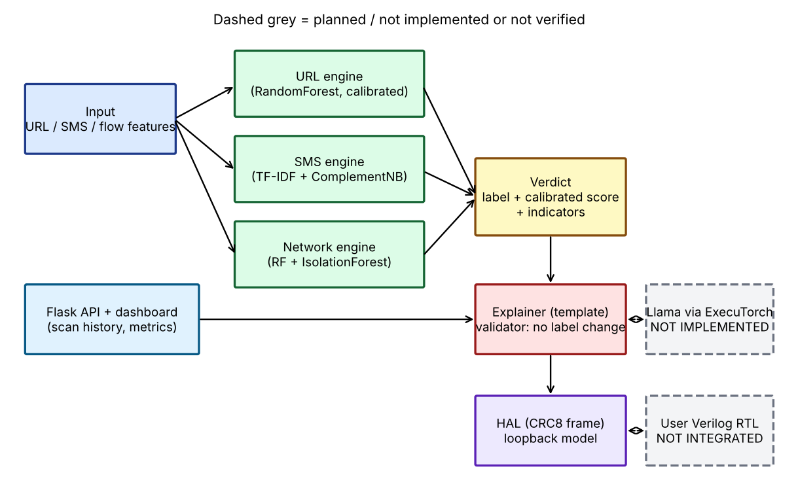

# ThreatShield AI

**On-device threat, phishing & scam detection** — prototype for the *Bharat AI-SoC Challenge 2026–27*, Problem Statement 3 (PS3).

**Author:** Krishna Bhardwaj ([@krishnabhardwaj8303-sys](https://github.com/krishnabhardwaj8303-sys)) · Companion hardware project: *Kavach-ID lite* (Verilog, simulation/synthesis only)

> ## Honest status (read first)
> | Area | Status |
> |---|---|
> | URL / SMS / network detectors, dashboard, tests | ✅ Working, reproducible |
> | Training data | ⚠️ **Synthetic only** — metrics are *not* real-world accuracy |
> | Llama-family model for explanations | ❌ **Not yet delivered** (template explainer used; optional Ollama backend never run) |
> | ExecuTorch deployment | ❌ **Not yet verified** (export script written, never executed) |
> | Arm device / emulator test | ❌ Not tested (all timings are x86_64) |
> | Kavach-ID hardware interface | 🟡 Python driver verified against the Kavach UART bridge + register map **in simulation only**; nothing run on hardware |
>
> Official PS3 lists **Llama + ExecuTorch** as required technologies; they are the main open gap. Details: [STATUS.md](STATUS.md).

## 1. Overview
Offline-first pipeline: three independent detectors (URL, SMS, network flow) → independent explanation layer with an evidence validator → optional hardware link. No cloud calls in the inference path.



## 2. Problem statement (PS3)
Detect phishing URLs, scam SMS and network anomalies; explain threats to non-experts; recommend remediation; run locally on Arm-based hardware without cloud dependency.

## 3. Features
- URL scan (17 lexical features, calibrated probability, evidence list)
- SMS scan (9 categories: banking, KYC, payment, delivery, OTP, prize, investment, phishing, legit)
- Network-flow scan (RandomForest + IsolationForest, z-score evidence)
- Risk levels (low/medium/high) with a "suspicious" band for uncertain scores
- Explainer + **validator** (rejects any explanation that changes the detector's label or cites unsupported evidence)
- Flask API + single-page dashboard, SQLite scan history, metrics page, hardware diagnostics (loopback model)

## 4. Technology stack
Python 3.12 · scikit-learn · NumPy/pandas/SciPy · Flask · SQLite · pytest · Icarus Verilog (interface simulation). Planned: Llama 3.2 1B via ExecuTorch (XNNPACK).

## 5. Repository layout
```
threatshield/        url_engine.py sms_engine.py net_engine.py pipeline.py app.py common.py
  data/synth.py      synthetic data generators (seeded)
  explain/engine.py  template + (optional) Ollama explainer, validator
  hal/link.py        7-byte CRC-8 result frame + loopback/UART links (proposal)
  hal/kavach.py      driver for Kavach-ID lite UART bridge (6-byte frame)
frontend/index.html  dashboard
models/              trained joblib models (version 0.1.0)
evaluation/          bench.py, results/*.json, logs
hardware/rtl/        proposed result-receiver Verilog + testbench (iverilog PASS)
hardware/kavach_integration/   co-simulation against the Kavach bridge/register map (RTL NOT included)
arm_deployment/      export_executorch.py (written, NOT yet run)
tests/  docs/  train_all.py  requirements.txt  STATUS.md
```

## 6. Installation
```bash
git clone https://github.com/krishnabhardwaj8303-sys/ThreatShield-AI.git
cd ThreatShield-AI
python -m venv .venv && source .venv/bin/activate
pip install -r requirements.txt
```

## 7. Run
```bash
python train_all.py            # optional: retrains and rewrites models/ + evaluation/results/
python -m threatshield.app     # dashboard: http://127.0.0.1:8000
python -m pytest -q tests      # 17 pass, 1 skipped without the Kavach RTL
```
Model files are `joblib` pickles: only load files you trust.

## 8. Evaluation (synthetic data, held-out test split)
| Model | Acc | Prec | Rec | FPR | FNR |
|---|---|---|---|---|---|
| URL RandomForest (calibrated) | 0.997 | 1.000 | 0.992 | 0.000 | 0.008 |
| SMS scam-vs-legit (unseen templates) | 0.957 | 0.954 | 1.000 | 0.425 | 0.000 |
| Network RandomForest | 0.993 | 0.984 | 0.994 | 0.007 | 0.006 |
| Network IsolationForest | 0.788 | 0.587 | 1.000 | 0.303 | 0.000 |

SMS 9-class macro-F1 on unseen message templates: **0.519** (weak; reported as measured). Splits: URL by registered domain, SMS by template, flows stratified. All values come from `train_all.py`; raw files in `evaluation/results/`. Confusion matrices: `docs/figures/`.
Desktop latency, x86_64 1 vCPU, median: URL 33 ms · SMS 1.3 ms · network 13 ms (`PYTHONPATH=. python evaluation/bench.py`). **Not Arm results.**

## 9. ARM / ExecuTorch / Llama
| Item | Status |
|---|---|
| Desktop x86_64 benchmark | ✅ done |
| ExecuTorch export of flow-classifier MLP (`arm_deployment/export_executorch.py`) | ⏳ pending, not executed |
| Llama 3.2 1B via ExecuTorch for explanations | ⏳ pending |
| Quantized vs unquantized size | ⏳ pending |
| Arm device / emulator | ⏳ pending |

## 10. Hardware integration (Kavach-ID lite)
- `hal/kavach.py` speaks the Kavach UART bridge's 6-byte frame: `[CMD][ADDR][DATA×4 MSB-first]`, CMD `0x01` write / `0x02` read (4-byte reply).
- `hardware/kavach_integration/run_cosim.py` drives those frames into the real `uart_to_reg_bridge` + `kavach_register_map` under Icarus Verilog: **COSIM PASS** (`evaluation/results/kavach_bridge_cosim.log`). The Kavach RTL is **not** in this repo; set `KAVACH_RTL_DIR` to your local copy.
- Caveats: a test model replaced the unsupplied `uart_tx.v`; the full top level was not simulated; no hardware was used. See [docs/KAVACH_INTEGRATION.md](docs/KAVACH_INTEGRATION.md).
- `hardware/rtl/` contains a separate *proposed* result-receiver (CRC-8 frame), simulated with iverilog (PASS).

## 11. Screenshots
Pending — to be added under `docs/screenshots/`.

## 12. Demo video
[Demo video link — pending]

## 13. Known limitations
Synthetic data only · weak SMS generalisation · high IsolationForest false-positive rate · no Llama/ExecuTorch yet · no Arm testing · URL model not yet optimised for edge · Kavach integration is simulation-level.

## 14. Roadmap
Llama 3.2 1B on ExecuTorch (Pi 5 / Arm Android) · retrain on real public datasets with verified licences · int8 export of a distilled URL model · Hinglish SMS data · optional on-chip verdict register in Kavach (requires RTL owner approval).

## 15. License and data
License: **[to be chosen by the repository owner]** — add a `LICENSE` file before publishing. Data: all synthetic (`threatshield/data/synth.py`); no third-party dataset used. Technical report: [docs/ThreatShield_AI_Technical_Report.pdf](docs/ThreatShield_AI_Technical_Report.pdf).
